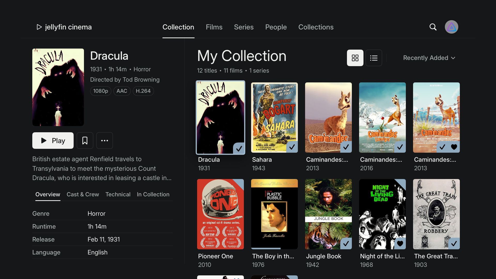

# Jellyfin Cinema (tvOS)

Jellyfin Cinema is the Apple TV interface of this fork: a quiet, Scandinavian-minimal
presentation of a personal film collection. The collection is the product; the interface
never competes with the artwork.

This is a native rewrite of the tvOS screens, not a theme. Everything below Jellyfin's
API (authentication, user management, playback, transcoding, subtitles, watch history,
permissions) is untouched, and the iOS app is unchanged.

## What the Apple TV app looks like

| Screen | What you see |
|---|---|
| Collection (landing) | A split view. Left: the selected title's poster, title, year · runtime · genre, director, format chips (4K UHD, HDR10, Dolby Atmos…), Play / favourite / more, synopsis, and tabs: Overview, Cast & Crew, Technical, In Collection. Right: "My Collection" with title counts, grid/list toggle, a sort menu, and the poster grid with title and year beneath each poster. Moving focus through the grid updates the panel; pressing a poster opens the full item page. |
| Films, Series, Collections, People | The same split view filtered to one kind. |
| Search, profile | Icons at the trailing edge of the navigation bar. Search opens Jellyfin's search page over the current screen; profile opens Settings. |
| Item page | The original poster beside the title, metadata, format chips, tagline, synopsis and the playback controls, on a flat background, followed by Jellyfin's cast, genre, similar-title and about sections. |
| Playback | Unchanged. |

There is no hero banner, no carousel, no "trending" or "recommended for you" section, and
no autoplay.

## Design tokens

Every value lives in `Swiftfin tvOS/Cinema/CinemaTheme.swift`.

| Token | Value |
|---|---|
| Background / secondary / elevated / hover | `#151719` / `#1B1E20` / `#222629` / `#292E31` |
| Text primary / secondary / muted | `#F0F1EF` / `#A8AEAD` / `#777F80` |
| Accent / secondary accent | `#8FA9BF` / `#B5C5D0` |
| Divider | white at 7.5 % |
| Focus ring | `#A8C0D2`, 4 pt, drawn 8 pt outside the control |
| Spacing | 4-point scale: 4, 8, 12, 16, 20, 24, 32, 40, 48, 64 |
| Radius | posters 8 pt, controls 10 pt |
| Motion | hover 150 ms, state 180 ms, panel 220 ms, ease-out / ease-in-out |

### Typography

Inter (SIL Open Font License, bundled as a variable font in `Swiftfin tvOS/Resources/Fonts`)
at three weights: 400 for body and metadata, 500 for navigation, labels and titles, 600 for
section headings. Sizes are tuned for a 1920 × 1080 canvas viewed from a distance:

| Role | Size |
|---|---|
| Screen title ("My Collection") | 58 regular |
| Selected title | 44 medium |
| Section heading | 30 semibold |
| Navigation, primary buttons | 27 medium |
| Body | 25 regular |
| Poster titles, table labels | 24 medium |
| Years, counts, secondary metadata | 23 regular |
| Format chips | 20 medium |

The accent colour is a per-user setting; the Cinema accent is the default for new users on
Apple TV.

## Architecture

New code is confined to `Swiftfin tvOS/Cinema/` and is only compiled for tvOS.

| File | Role |
|---|---|
| `CinemaTheme.swift`, `CinemaFont.swift` | Tokens and the Inter loader (`wght` and `opsz` axes). |
| `CinemaShellView.swift`, `CinemaNavigationBar.swift` | The persistent navigation bar above the selected tab. Tabs are created the first time they are selected and then kept alive, each with its own navigation coordinator, so deep links, pushes and playback behave as before. Menu at a tab root moves focus to the bar; Menu on any bar item other than Collection returns to Collection; Menu on Collection leaves the app, as with the system bar. Selecting a destination moves focus to its first poster, as the system bar does. |
| `CinemaTabItems.swift` | The destinations: Collection, Films, Series, People, Collections, the Settings tab behind the profile image, and the search route presented from the bar. |
| `CinemaCollectionView.swift` | The split view over Jellyfin's `PagingLibraryViewModel`: paging, sorting and refresh are the existing library machinery. |
| `CinemaDetailPanel.swift`, `CinemaDetailPanelViewModel.swift` | The selected-item panel. The panel first shows what the grid already knows, then fetches the full item (overview, people, media streams) 300 ms after focus settles and resolves what Play would start, including the next episode of a series. Favourite and played toggles go through the shared item store. |
| `CinemaPosterCell.swift`, `CinemaListRow.swift` | Grid and list cells with the Cinema focus treatment. Watched and progress indicators remain available through the poster indicator settings. |
| `CinemaMediaFormat.swift` | Derives "4K UHD", "HDR10", "Dolby Vision", "Dolby Atmos", "DTS-HD MA", "HEVC" and the Technical table from the media streams the server reports. Nothing is shown that the server did not return. |
| `CinemaItemHeaderContentGroup.swift` | The item page header used in place of the backdrop header on tvOS. |
| `CinemaButtonStyles.swift`, `CinemaComponents.swift` | Button styles, chips, dividers and the metadata table. |

Shared files changed for tvOS only: `MainTabView` (uses the shell), `ItemView` (Cinema header,
flat background), `NavigationInjectionView` (flat presentation background), `PlayButton` and
`ItemActionButtons` (Cinema styles), `SwiftfinDefaults` and `ThemePreferencesEnvironment`
(default accent, cinematic background off), `CustomizeSettingsView` (the tab bar placement
setting no longer applies).

New strings: `directedBy`, `films`, `filmsWithCount`, `seriesWithCount`, `collectionsWithCount`,
`peopleWithCount`, `titlesWithCount`, `inCollection`, `myCollection`, `technical`
(`Translations/en.lproj/Localizable.strings`, regenerated into `Shared/Strings/Strings.swift`).

## Limitations

- Sections below the item header (cast, genres, similar titles, about) and the Settings,
  Search and sign-in screens keep Jellyfin's native components and the system font.
- "In Collection" lists what Jellyfin exposes for an item: date added, seasons and episodes,
  played state, play count, last played, favourite and tags. The server does not report which
  box sets contain a title.
- People cannot be re-sorted; the server returns them by name.
- Jellyfin's filter drawer (genre, year, rating filters) is not shown on the collection
  screen; sorting is. The filters remain on library pages opened from an item.

## Verification

Checked on the Apple TV 4K (1080p) simulator, tvOS 27.0, signed in to the public Jellyfin demo
server (Jellyfin 12.4): sign-in, the Collection, Films, Series, People and Collections screens,
grid and list layouts, every sort option, the panel's four tabs and its Play, favourite and menu
controls, the film and series pages and their sections, Search, Settings, and Menu behaviour at
every level. Focus moves into the grid after a destination is chosen, after a sort change and
after a layout change, as it does with the system tab bar; Menu from a grid moves focus to the
bar, Menu on any bar item other than Collection returns to Collection, and Menu on Collection
leaves the app. Playback itself was not exercised in the simulator.

Visited tabs stay alive behind the selected one so returning to them keeps their scroll position
and selection; this is the same cost the system tab bar incurs.

## Building

The project is unchanged for building: open `Swiftfin.xcodeproj`, choose the `Swiftfin tvOS`
scheme and an Apple TV simulator. The first build asks you to trust the two Swift macro
packages (`swift-case-paths`, `StatefulMacro`); from the command line, pass
`-skipMacroValidation` to `xcodebuild`.
